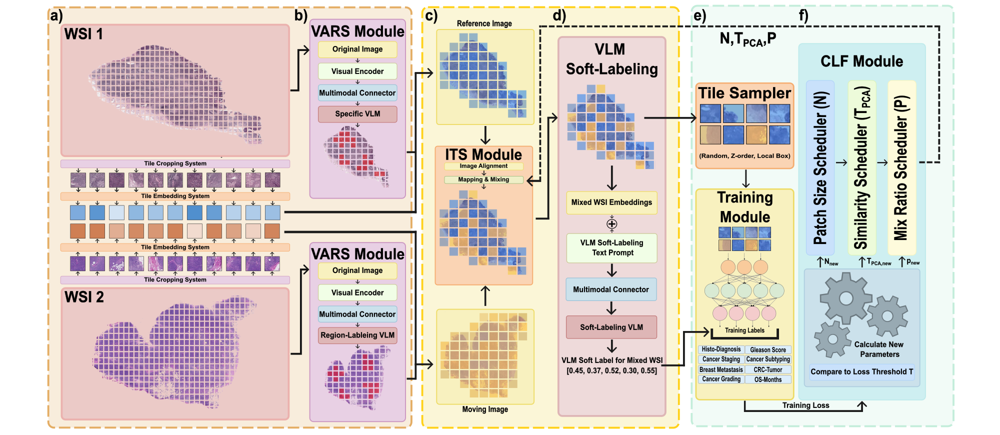

<p align="center">
  
</p>

# SlideMix: Enhancing Whole Slide Image Analysis via Multimodal Shuffling

Official implementation of **SlideMix**, a data augmentation method for multiple instance learning (MIL) on whole slide images (WSIs). SlideMix creates new training slides by shuffling tile embeddings between two slides in place, guided by vision-language models, and assigns soft labels to the mixed slides.

Find our preprint here: [[Paper]](https://arxiv.org/abs/2609.00396)


## Citation

If you find SlideMix useful, use any part of our code, or draw inspiration from our work, we would appreciate it if you could cite our paper:

```bibtex
@article{wong2026slidemix,
  title={SlideMix: Enhancing Whole Slide Image Analysis via Multimodal Shuffling},
  author={Wong, Chad and Chen, Sicheng and Zhang, Tianyi and Chai, Enhui and Jin, Yueming and Liu, Zeyu and Xia, Fei},
  journal={arXiv preprint arXiv:2609.00396},
  year={2026},
  doi={10.48550/arXiv.2609.00396},
  url={https://arxiv.org/abs/2609.00396}
}
```


## Colab demo

[](TODO)

Coming soon.

The demo requires a GPU runtime (Runtime > Change runtime type > GPU) and a download of the demo set of slides.

## Repository structure

```
main.py                      training / testing entry point
utils/
  slidemix.py                alignment, PCA filter, ITS, curriculum, soft labels
  slidemix_callback.py       curriculum feedback callback
  slidemix_vlm.py            CONCH text encoding and tile-level scoring
  dataset.py, model.py, utils.py, CONSTS.py
models/
  ABMIL.py                   MIL backbone
  CONCH/, clip/              CONCH and BiomedCLIP model code
tools/
  slidemix_rag.py            PubMed retrieval corpus and index
  slidemix_var_selector.py   per-slide ROI masks (VARS)
  slidemix_vlm_scores.py     per-tile VLM class scores
dataset_configs/             task definitions and 5-fold splits
```

## Installation

```bash
conda create -n slidemix python=3.12
conda activate slidemix
pip install -r requirements.txt
```

CONCH weights are downloaded from the Hugging Face Hub and require access to [MahmoodLab/conch](https://huggingface.co/MahmoodLab/conch). Set `HF_TOKEN`, or pass a local checkpoint with `--conch_checkpoint`. 

## Data preparation

SlideMix trains on tile embeddings stored as one `.safetensors` file per slide, with `features` `[N, D]` and `coords_yx` `[N, 2]` (level-0 pixel coordinates):

```
<data_path>/<dataset_name>/tiles-embeddings/<slide_id>.safetensors         # GigaPath
<data_path>/<dataset_name>/tiles-embeddings_conch/<slide_id>.safetensors   # CONCH (for VARS and VLM labels)
```

Labels and fold assignments are read from `dataset_configs/<dataset_name>/`. Configurations are provided for PANDA, CAMELYON16, IMP-CRS-2024, TCGA-lung, TCGA-BLCA, TCGA-BRCA, TCGA-CESC, TCGA-GBM, TCGA-UCEC, TCGA-UCS and TCGA-UVM.

## Usage

### 1. Retrieval corpus (optional)

```bash
python tools/slidemix_rag.py fetch --dataset_name CAMELYON16 --out rag/docs.jsonl
python tools/slidemix_rag.py build --docs rag/docs.jsonl --out_dir rag/index
```

### 2. ROI masks (VARS)

```bash
python tools/slidemix_var_selector.py --data_path $DATA --dataset_name CAMELYON16 \
    --mode gemini --wsi_dir $WSI --rag_index rag/index --out_dir slidemix/roi --device cuda
```

`--mode conch` grounds the region prompt with CONCH alone, without raw WSIs.

### 3. VLM soft-label scores

```bash
python tools/slidemix_vlm_scores.py --data_path $DATA --dataset_name CAMELYON16 \
    --rag_index rag/index --out_dir slidemix/vlm --device cuda
```

### 4. Training

Baseline:

```bash
python main.py --mode train --data_path $DATA --dataset_name CAMELYON16 \
    --model_name ABMIL --embedding_name GigaPath --fold 1 --devices 0
```

With SlideMix:

```bash
python main.py --mode train --data_path $DATA --dataset_name CAMELYON16 \
    --model_name ABMIL --embedding_name GigaPath --fold 1 --devices 0 \
    --slidemix --slidemix_roi_dir slidemix/roi --slidemix_vlm_dir slidemix/vlm
```

The best checkpoint is evaluated on the test split after training. Mixing is applied to the training split only.

### Main SlideMix options

| Flag | Default | Description |
|---|---|---|
| `--slidemix_prob` | 0.5 | probability that a training slide is mixed |
| `--slidemix_N` | 16,8,4,2,1 | block granularity per curriculum stage |
| `--slidemix_TPCA` | 1.0,0.8,0.6,0.4,0.2 | PCA distance threshold per stage |
| `--slidemix_P` | 0.1,0.2,0.3,0.4,0.5 | shuffling ratio per stage |
| `--slidemix_strategy` | hold | behaviour when the loss does not improve: `hold`, `back`, `fixed` |
| `--slidemix_warmup_epochs` | 20 | epochs without mixing before the curriculum starts |
| `--slidemix_label` | vlm | soft-label method: `vlm`, `linear`, `random` |

Run `python main.py --help` for the full list.

## Acknowledgements

This code builds on [CONCH](https://github.com/mahmoodlab/CONCH), [OpenCLIP](https://github.com/mlfoundations/open_clip), [BiomedCLIP](https://huggingface.co/microsoft/BiomedCLIP-PubMedBERT_256-vit_base_patch16_224) and [ABMIL](https://github.com/AMLab-Amsterdam/AttentionDeepMIL).
